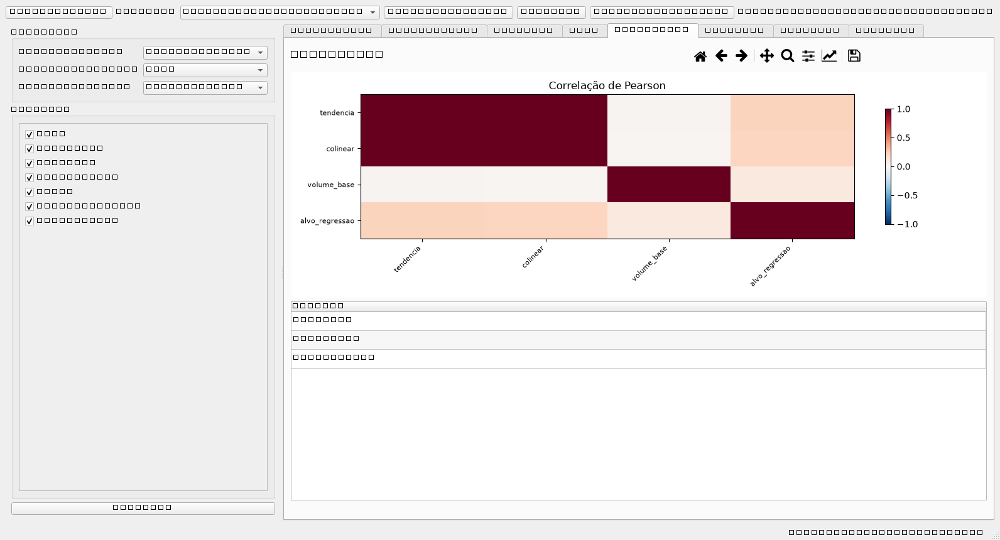
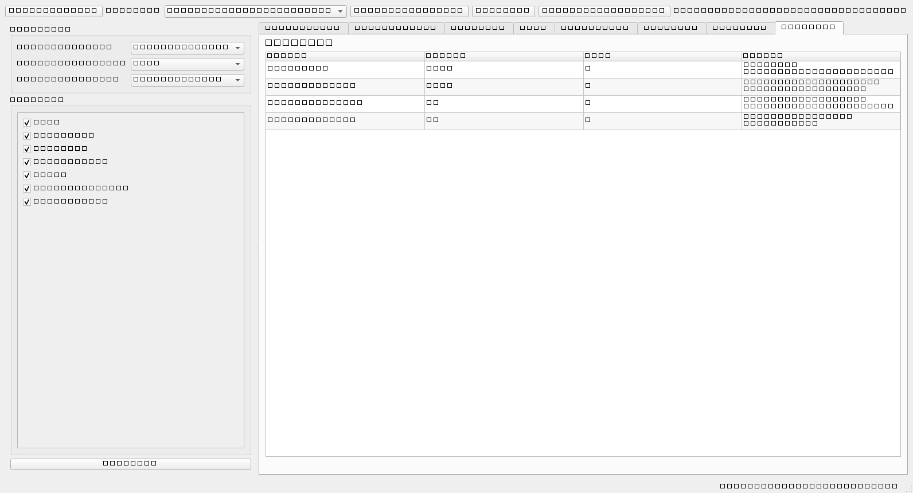

# EdaMetricas


-41CD52?logo=qt&logoColor=white)


**EDA genérico com veredito:** carregue qualquer CSV, XLSX, Parquet ou JSON, escolha o alvo e descubra — com estatística de verdade, não com achismo — se seus dados servem para **regressão, classificação, clusterização ou série temporal**.





## Por que existe

Toda análise exploratória acaba nas mesmas perguntas: *esse dataset dá pra prever algo? Quantas linhas eu preciso? Essa coluna estraga o modelo?* O EdaMetricas responde isso num lugar só — e no final entrega um **parecer com semáforo (✅ ⚠️ ❌) para cada tipo de tarefa**, com as razões escritas:

> ⚠️ *Série temporal com ressalvas: ADF indica série não estacionária — considere diferenciação.*

> ❌ *Classificação: desbalanceamento severo (razão 15:1) — considere reamostragem.*

Nada de número solto: cada veredito vem com a justificativa e a métrica que o gerou.

## O que ele faz

- **Lê qualquer arquivo tabular** — CSV, XLSX, Parquet, JSON — e infere o tipo de cada coluna (numérica, categórica, temporal, ID de alta cardinalidade);
- **8 abas de análise**: Visão Geral, Estatísticas, Ausentes, Alvo, Correlação, Outliers, Temporal e Veredito;
- **Testes estatísticos reais**: ADF (estacionariedade), Shapiro-Wilk (normalidade), Levene (homocedasticidade), ANOVA/Kruskal-Wallis, Qui-quadrado, VIF (multicolinearidade), Cramér's V, eta-squared;
- **Regras de mercado documentadas**: tamanho amostral pela regra de Green (n ≥ 50 + 8k), alerta de desbalanceamento, limiar de ausentes, IQR/Z-score para outliers;
- **Tooltips em tudo** — passe o mouse sobre qualquer métrica e leia o que ela significa e como interpretá-la;
- **8 datasets de exemplo embutidos** (regressão, classificação, série temporal, desbalanceado, com ausências, multicolinear, não estacionária e um "completo" que preenche todas as abas);
- **Exporta relatório HTML autossuficiente** — tabelas, gráficos embutidos e veredito, pronto para anexar a relatório ou enviar por e-mail;
- **Gráficos com zoom/pan/salvar** embutidos (toolbar do matplotlib) e área de gráfico que só aparece quando há gráfico.

## As 8 abas em resumo

| Aba | O que mostra |
|---|---|
| Visão Geral | shape, memória, duplicatas, colunas constantes e de alta cardinalidade |
| Estatísticas | média, mediana, desvio, assimetria, curtose, IQR, CV — por coluna |
| Ausentes | % por coluna, sugestão de remoção/imputação por tipo |
| Alvo | tipo detectado (regressão × classificação), normalidade, balanceamento, transformações sugeridas |
| Correlação | heatmap Pearson/Spearman, VIF, ranking de features contra o alvo |
| Outliers | IQR, Z-score e Isolation Forest (multivariado) |
| Temporal | ADF, frequência detectada, período sazonal estimado via ACF |
| Veredito | parecer com semáforo para as 4 tarefas de ML, com as razões |

## Instalação

Requisito: Python 3.11 ou mais novo (testado até 3.14).

```bash
# dentro da pasta do projeto
python -m venv .venv
.venv\Scripts\pip install -r requirements.txt      # Windows
# source .venv/bin/activate && pip install -r requirements.txt   # Linux/macOS

.venv\Scripts\python main.py                       # Windows
# .venv/bin/python main.py                        # Linux/macOS
```

## Uso em 4 passos

1. **Abrir Dataset** (ou **Carregar Exemplo**, se quiser testar sem arquivo);
2. No painel lateral, marque as **features**, escolha o **alvo**, a **coluna de tempo** (se houver) e a **tarefa** — ou deixe em *auto-detectar*;
3. Clique em **Analisar** (ou deixe o app analisar sozinho ao carregar);
4. Navegue pelas abas e clique em **Exportar Relatório** quando quiser o HTML.

## Arquitetura

Separação rígida entre cálculo e interface — a lógica estatística não conhece Qt:

```
EdaMetricas/
├── main.py                 # ponto de entrada
├── core/                   # lógica pura, testável, sem PySide6
│   ├── data_loader.py      # leitura + inferência de tipos
│   ├── descriptive_stats.py
│   ├── sample_size.py      # regra de Green, desbalanceamento
│   ├── missing_values.py
│   ├── correlation.py      # Pearson/Spearman/Cramér/eta²/VIF
│   ├── outliers.py         # IQR, Z-score, Isolation Forest
│   ├── statistical_tests.py # Shapiro, Levene, ANOVA, Qui²
│   ├── target_analysis.py  # regressão × classificação
│   ├── temporal_analysis.py # ADF, frequência, sazonalidade
│   ├── verdict_engine.py   # consolida tudo no parecer
│   └── report.py           # relatório HTML autossuficiente
├── ui/                     # PySide6: janela, abas, widgets
├── utils/                  # limiares centralizados + formatação
└── tests/                  # pytest com datasets sintéticos
```

Todos os limiares (VIF 5/10, IQR ×1,5, ausentes 10%/30%, desbalanceamento 3:1/5:1...) ficam em `utils/constants.py` — nenhum número mágico espalhado pelo código.

## Testes

```bash
.venv\Scripts\python -m pytest tests/ -q
```

11 testes cobrindo os módulos de `core/` com datasets sintéticos (regressão, classificação e série temporal).

## História

O EdaMetricas nasceu durante um trabalho de deep learning da disciplina — a gente precisava validar uma base de preços de boi gordo (séries CEPEA, câmbio do BCB, abate do MAPA, USDA) antes de treinar RNNs, e as verificações viraram checklist, o checklist virou script, e o script virou app. Como a ferramenta nunca teve uma coluna hardcoded de boi, ela acabou genérica — e agora analisa qualquer dataset tabular que você jogar nela.

## Limitações (por honestidade)

- Lê **um arquivo por vez** — não faz merge entre fontes;
- Não calcula lags/retornos/diferenças — variáveis derivadas entram prontas pelo usuário;
- Não treina modelos: o veredito diz se os dados **servem** para a tarefa, não treina a tarefa;
- Séries muito curtas (< 30 pontos) geram mais avisos do que conclusões — de propósito.

## Roadmap

- [ ] Tema escuro
- [ ] Comparação lado a lado de dois datasets
- [ ] Exportar relatório em PDF
- [ ] Detecção de vazamento em séries temporais (colunas com defasagem de divulgação)

## Contribuindo

Issue e PR são bem-vindos. Se for mexer em `core/`, mantenha a regra da casa: **sem PySide6 ali dentro** — os testes agradecem.

## Licença

MIT — veja [LICENSE](LICENSE).
